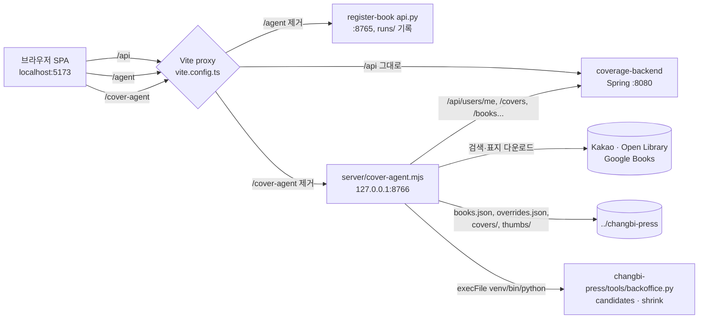
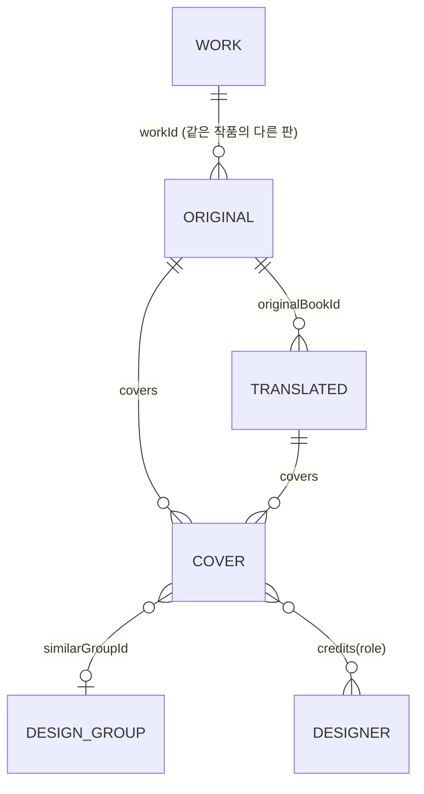
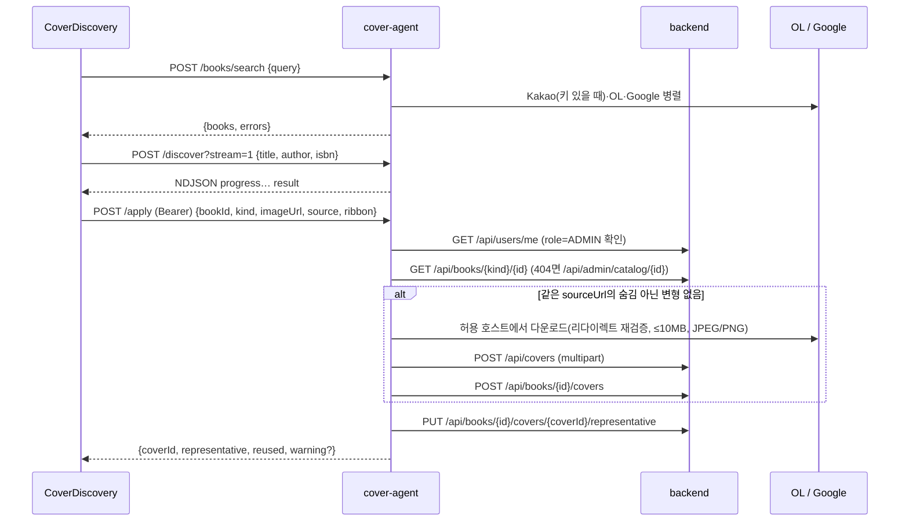

# 아키텍처

COVERAGE 서비스의 도서·표지 데이터를 관리자가 수집·검토·공개하는 백오피스다. 이 저장소는 SPA(`src/`)와 로컬 보조 서비스 하나(`server/cover-agent.mjs`)로 구성된다. 데이터의 원본은 형제 저장소 `../coverage-backend`(Spring)에 있다.

엔드포인트 계약은 [API.md](API.md), 실행·테스트·컨벤션은 [DEVELOPMENT.md](DEVELOPMENT.md)를 본다.

## 런타임 구성

- 세 백엔드 모두 **같은 출처**로 호출한다. 백엔드에 CORS가 없으므로 배포에서도 한 출처에서 세 경로를 라우팅해야 한다.
- cover-agent는 의존성 없는 `node:http` 서버이며 127.0.0.1에만 바인딩한다. 관리자 권한 확인을 직접 하지 않고 백엔드 `/api/users/me`에 위임한다.
- 백엔드가 쓰는 PostgreSQL·Redis·Elasticsearch·Kafka·S3(RustFS)는 이 저장소에서 직접 접근하지 않는다(`../coverage-backend`의 `docker compose`).

## 디렉터리

| 경로 | 역할 |
|---|---|
| `src/main.tsx`, `src/App.tsx` | 진입점. `App.tsx`에 사이드바 `MENU`, 전체 `Routes`, 퍼블리시 드롭 처리, 토스트, 펜딩 수 배지가 있다 |
| `src/pages/*.tsx` | 화면 하나당 파일 하나. 상태·데이터 로딩·하위 컴포넌트를 같은 파일에 둔다 |
| `src/api.ts` | `api<T>()`(백엔드), `coverAgent<T>()`(cover-agent POST), `session()`, `ApiError`, `safeUrl()`, `SearchItem`, `CHANGBI_DRAG` |
| `src/catalog.ts` | 도서·표지 타입(`Cover`, `CatalogItem`, `Book`, `Detail`), 라벨 상수, `imageOf`/`coversOf`/`loadEditions` |
| `src/changbi.ts` | `ChangbiBook` 타입, 판정(`usable`/`translated`/`thumbUrl`), `/changbi/books` 세션 캐시 |
| `src/GlobalSearch.tsx` | 사이드바 검색 팔레트(`/` 키) |
| `src/useWork.ts` | 버튼 작업의 `busy`/`error`/`message` 상태 |
| `src/ui.tsx`, `src/lang.ts` | Spring `Page<T>` 타입·`Pager`, 언어 코드 → 한국어 이름 |
| `src/index.css` | 전역 스타일 하나(CSS 모듈·프레임워크 없음) |
| `server/cover-agent.mjs` | 표지 탐색·적용, 창비 자료실 서비스 |
| `server/cover-agent.test.mjs` | `node:test` 단위 테스트(네트워크·백엔드 스텁) |
| `tests/browser/` | Playwright 회귀 테스트(API 모킹) |
| `docs/*-YYYY-MM-DD.md` | 특정 날짜의 검증 기록(파일명이 날짜로 끝남). 현재 동작의 명세가 아니다 |

## 화면과 라우트

`src/App.tsx`의 `MENU`가 사이드바 순서(수집 → 검토·공개 → 관리)를 정한다.

| 라우트 | 파일 | 주 데이터 출처 |
|---|---|---|
| `/dashboard` | `Dashboard.tsx` | `/api/admin/dashboard/stats`, `/api/admin/dashboard/logs*` |
| `/publishers/changbi` (`/changbi` 리다이렉트) | `Changbi.tsx` | cover-agent `/changbi/*`, `/api/search` |
| `/cover-discovery` | `CoverDiscovery.tsx` | cover-agent `/books/search`·`/discover`·`/apply`, `/api/search`, `loadEditions` |
| `/publish` | `Publish.tsx` | `/api/admin/books?status=DRAFT`, `PUT /api/books/original/:id`, `/api/admin/moderation/content/restore` |
| `/covers`, `/covers/:originalId` | `Covers.tsx` | `/api/search`(실패 시 DB 검색), `/api/admin/covers/:id/similar-group` |
| `/books`, `/books/attention` | `Books.tsx` | `/api/admin/catalog` |
| `/books/:id` | `BookDetail.tsx` + `BookRelationships.tsx` | `/api/admin/catalog/:id` 외 |
| `/image-duplicates` | `ImageDuplicates.tsx` | `/api/admin/image-inspection/*` |
| `/entities` | `Entities.tsx` | `/api/{authors,publishers,designers}`, `/api/admin/entities/*`, `/api/admin/search/reindex` |
| `/runs`, `/runs/:file` | `Runs.tsx` | `/agent/runs` |
| `/login`, 그 외 | — | `/cover-discovery`로 리다이렉트 |

## 도메인 모델

원본 스키마는 백엔드에 있다. 프런트엔드 타입은 `src/catalog.ts`에 모여 있다.

- **도서 = 판(ISBN·출판사·판)**. 판이 다르면 별도 도서다. 번역서는 반드시 원서 하나에 붙는다(`/books/original/:id`, `/books/translated/by-original/:id`).
- **표지 변형(Cover)** 은 한 도서에 여러 개이며 그중 하나가 `frontCover`(대표). `coversOf(book)`는 대표와 `covers`를 ID로 중복 제거해 합친다.
- 표지 메타데이터: `variantType`(`VARIANT_LABELS`), `ribbonStatus`(`RIBBON_LABELS`, 띠지), `printingFrom`(시작 쇄), `usedFrom`, `sourceName`/`sourceUrl`(이미지 제공처), `copyrightHolder`(저작권자, 크레딧·출처에서 추정하지 않는 별도 값), `credits`(디자이너와 역할).
- **디자인 묶음(`similarGroupId`)** 은 관리자가 확인해 묶은 유사 디자인이다. 언어·판이 달라도 묶을 수 있고, 같은 이미지 URL이나 파일 해시와는 무관하다.
- **상태**: `DRAFT`(펜딩) → `PUBLISHED` / `HIDDEN` / `DELETED`. 사용자 화면은 `PUBLISHED`만 노출한다. `DELETED` 도서는 상세에서 읽기 전용이다.
- **보완 항목(`ISSUE_LABELS`)** 은 목록 필터와 배지용이며 공개 차단 조건이 아니다.
- **이미지 동일성** 세 가지를 섞지 않는다: `EXACT_FILE`(저장 바이트 SHA-256 `file_sha256`), `SAME_URL`(같은 저장 주소), `SIMILAR`(dHash 거리 ≤6·종횡비 차이 ≤3%의 검토 후보). 백엔드의 기존 `sha256`은 차단용 픽셀 해시로 별개다.

창비 자료(`ChangbiBook`, `src/changbi.ts`)는 백엔드 도서가 아니다. `../changbi-press/books.json`에 `overrides.json`을 URL 키로 덮어쓴 값이며, `key`는 원본 `url`이다. `cover_status`는 `clean`/`띠지`/`미확인`/`여러권`/`오류`이고 `clean`·`띠지`만 사용 가능(`usable`)하다. 백엔드에 올린 뒤에는 `applied`가 기록된다.

## 주요 흐름

### 온라인 표지 적용 (`CoverDiscovery.tsx` → `/apply`)

대표 지정만 실패하면 변형은 남기고 `representative: false`와 `warning`을 반환한다.

### 창비 자료실 → 퍼블리시

1. `Changbi.tsx`가 `loadChangbiBooks()`로 전체 목록(약 1.9MB)을 세션에 한 번 받는다.
2. `미확인` 표지는 `/changbi/candidates`로 보도자료 zip을 풀어 후보를 보고, `/changbi/pick`으로 표지와 띠지 여부를 고른다(`overrides.json`에 기록, `collect.py`도 이 값을 따른다).
3. 이미 등록된 도서에는 `/changbi/apply`로 표지를 붙인다(위의 `attachCover` 경로 공유).
4. 새 책은 카드를 사이드바 **퍼블리시**에 드롭 → `App.tsx`가 `/changbi/register` 호출 → 백엔드에 `status: DRAFT` 원서 생성 → `overrides.json`에 `applied` 기록.
5. `Publish.tsx`에서 서지정보를 고치고(`PUT /api/books/original/:id`) 공개(`POST /api/admin/moderation/content/restore`)한다.

번역서(`original_title` 또는 `translators`가 있는 책)는 붙일 원서가 필요해 등록을 거절한다. 화면의 `canQueue`(`Changbi.tsx`)와 서버 조건(`registerChangbiBook`)이 같아야 한다.

### 화면 간 신호

전역 상태 라이브러리가 없다. 다음 장치로 화면을 맞춘다.

| 장치 | 발신 | 수신 |
|---|---|---|
| `window` 이벤트 `publish:queued` (`detail: {key, applied}`) | `App.tsx` 드롭 성공 | `Changbi.tsx`(카드 갱신), `Publish.tsx`(목록), 펜딩 배지 |
| `window` 이벤트 `publish:changed` | `Publish.tsx` 공개 | 펜딩 배지(`usePendingCount`) |
| `patchChangbiBook(key, change)` | `Changbi.tsx` pick/apply/register 후 | 창비 캐시를 읽는 전역 검색 |
| URL 파라미터 `?id=`(`/publish`), `?key=`(`/publishers/changbi`) | `GlobalSearch.tsx` | 화면이 한 번 읽고 `replace`로 지운다 |
| URL 파라미터 `?back=`, 목록 필터, `?originalId=&bookId=`, `?bookId=` | 목록·상세 링크 | `BookDetail`, `CoverDiscovery`, `ImageDuplicates` |

### 도서 상세의 미저장 입력 보호 (`BookDetail.tsx`)

- 폼마다 `markDirty(key, dirty)`로 등록하고, 하나라도 dirty면 탭 전환·링크 클릭(캡처 단계 `click`)·창 닫기(`beforeunload`)에서 확인한다.
- `CoverEditor`는 표지 ID를 key로 쓰고 카드별 `savedForm`을 둔다. 서버 갱신(`reload`)이 와도 **dirty가 아닌 카드만** 동기화한다. key에 전체 revision을 넣으면 다른 카드의 입력이 사라진다(2026-10-28 수정, `tests/browser/cover-drafts.spec.ts`).
- `reload`는 요청 번호(`reloadRequest`)로 늦게 도착한 오래된 응답을 버린다.

### 도서 관계 변경 (`BookRelationships.tsx`)

미리보기(`POST .../relationship-preview`) → 적용(`PUT .../relationship`)의 두 단계다. 적용 시 미리보기에서 받은 `expectedOriginalId`·`expectedWorkId`·`expectedTargetWorkId`를 보내 그 사이 연결이 바뀌었으면 백엔드가 거절한다. 도서·표지·ISBN을 병합하지 않는다.

## 설계 의도와 트레이드오프

- **보조 서비스를 Node 하나로**: 외부 이미지 다운로드·로컬 파일 접근은 브라우저에서 할 수 없고 백엔드에 넣기엔 로컬 수집 데이터(`../changbi-press`)에 묶여 있어 별도 로컬 서비스로 분리했다. 의존성 0, 함수마다 `fetcher`/`callBackend`/`tool`/`dir`를 주입해 테스트한다.
- **로그인 UI 제거(개발 미리보기)**: 화면은 인증 없이 열리지만 변경 API는 ADMIN 토큰이 필요하다. 토큰은 sessionStorage `coverage-backoffice-session`의 `{token, user}`를 읽는다. 토큰이 없으면 관리자 API는 401/403이며 화면은 이를 안내 문구로 바꾼다.
- **검색 내결함성**: 외부 출처·검색 인덱스 일부가 실패해도 나머지 결과를 보여준다(`searchBooks`/`discover`의 `errors`, `Covers.tsx`의 DB 폴백, `GlobalSearch`의 그룹별 `note`).
- **중복 업로드 방지**: `attachCover`는 같은 `sourceUrl`의 숨김 아닌 변형이 있으면 재사용한다. 창비 표지의 `sourceUrl`은 `원본URL#내용해시16자-띠지` 형식이라 이미지나 띠지 판정을 바꾸면 새 변형이 된다.
- 알려진 한계는 코드의 `ponytail:` 주석에 있다: `overrides.json` 쓰기는 프로세스 내에서만 직렬화, `/changbi/register`는 표지 업로드 후 도서 생성이 실패하면 업로드 파일이 남음, 번역서 등록 미지원.
